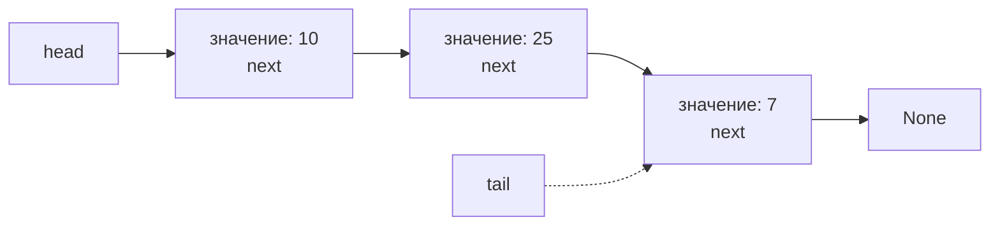
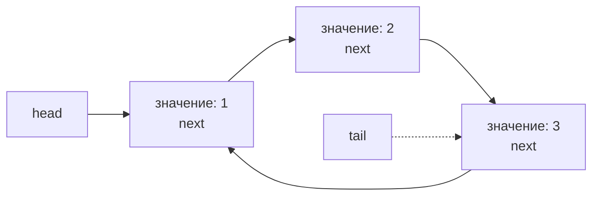
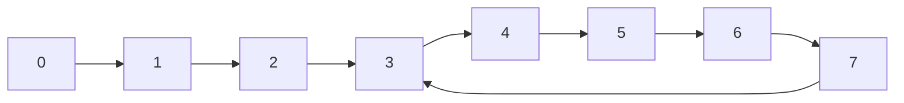
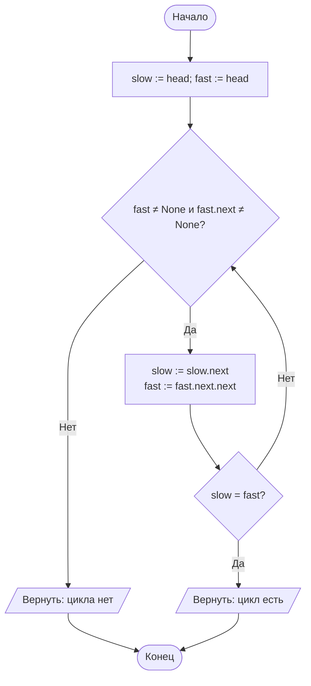
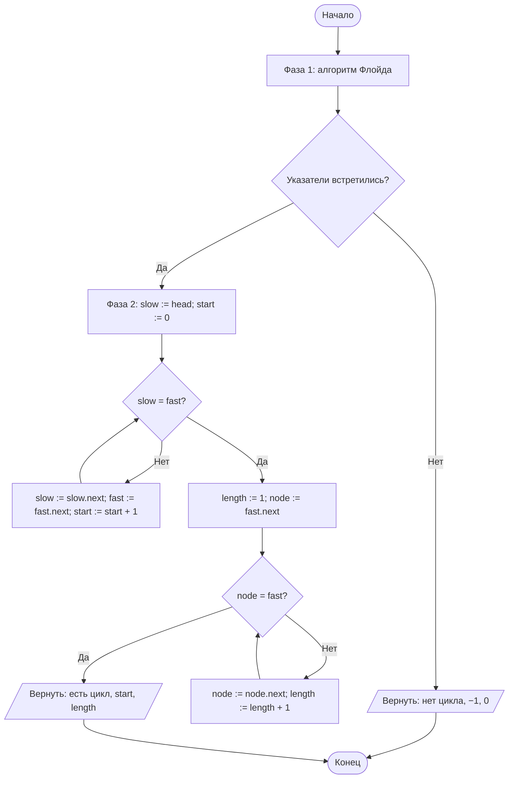
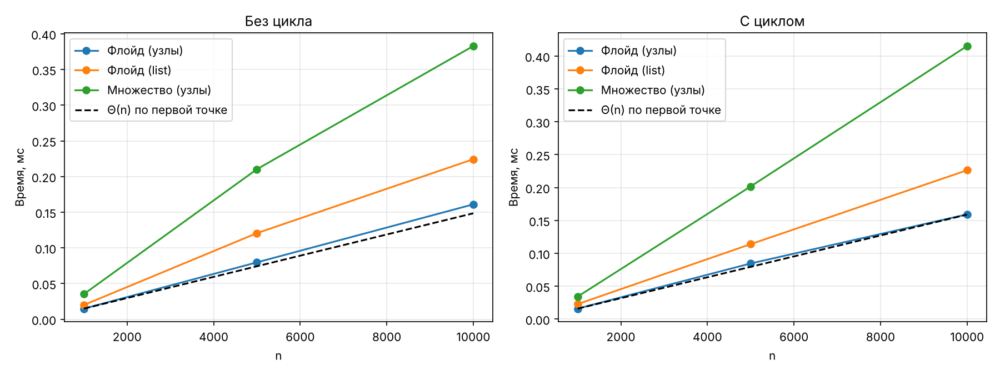

# Отчёт по лабораторной работе № 6

## Реализация линейных структур данных и анализ трудоёмкости их операций

---

## 1. Титульный лист

| | |
|---|---|
| **Дисциплина** | Теория алгоритмов |
| **Направление подготовки** | 38.03.05 «Бизнес-информатика» |
| **Курс** | 2 |
| **Лабораторная работа** | № 6. Реализация линейных структур данных и анализ трудоёмкости их операций |
| **Вариант** | 19 |
| **Выполнила** | Ситникова Ольга, группа БИ2-1 |
| **Проверил** | ______________________ |
| **Год** | 2026 |

---

## 2. Цель работы и задание варианта

**Цель работы:** изучить линейные структуры данных (связный список, кольцевой список), реализовать их на основе связанных узлов и экспериментально установить, как выбор структуры данных определяет трудоёмкость типовых операций.

**Задание варианта 19:**

| Параметр | Значение |
|---|---|
| Структуры для реализации | односвязный список, кольцевой список |
| Исследуемая операция | поиск цикла в списке |
| Размеры $n$ | 1000; 5000; 10 000 |
| Прикладная задача | диагностика ссылочной структуры |

**Дополнительные требования (для всех вариантов):**

| Код | Содержание | Где выполнено |
|---|---|---|
| Т1 | Проверка структур на малом примере с выводом содержимого после каждой операции | п. 6.1 |
| Т2 | Время исследуемой операции для собственной реализации и для встроенного `list` | п. 6.2 |
| Т3 | График $T(n)$ и определение, какой оценке ($\Theta(1)$ или $\Theta(n)$) соответствует каждая кривая | п. 6.2 |
| Т4 | Расход памяти на 10 000 элементов с помощью `sys.getsizeof` | п. 6.3 |

---

## 3. Описание реализованных структур и их операций

### 3.1. Односвязный список (`LinkedList`)

Каждый элемент хранится в узле `Node` (поля `value` и `next`). Список хранит ссылки на голову (`head`) и хвост (`tail`) и число элементов `size`. Реализованы методы, требуемые заданием:

| Метод | Назначение | Трудоёмкость |
|---|---|---|
| `push_front(v)` | вставка в начало | $\Theta(1)$ |
| `push_back(v)` | вставка в конец (используется ссылка `tail`) | $\Theta(1)$ |
| `insert(i, v)` | вставка по индексу | $\Theta(n)$ (поиск позиции), перестановка ссылок $\Theta(1)$ |
| `pop_front()` | удаление из начала | $\Theta(1)$ |
| `get(i)` | доступ по индексу | $\Theta(n)$ |
| `find(v)` | поиск значения | $\Theta(n)$ |
| `__len__()` | число элементов | $\Theta(1)$ |

Дополнительно реализованы `to_list()` (содержимое для вывода) и генератор `nodes()`; оба ограничены числом `size`, поэтому корректно работают и для кольцевого списка.

### 3.2. Кольцевой список (`CircularList`)

Это односвязный список, у которого ссылка последнего узла указывает на первый: `tail.next = head`. Класс наследует все методы `LinkedList` и переопределяет только `push_front`, `push_back` и `pop_front`, чтобы после каждой операции кольцо оставалось замкнутым. При удалении кольцо временно размыкается, чтобы не нарушить логику удаления последнего элемента. Так как обход ограничен `size`, он не зацикливается.

### 3.3. Поиск цикла в списке

Цикл возникает, когда ссылка `next` некоторого узла указывает на один из предыдущих узлов; тогда обход списка не заканчивается. Исследованы три способа:

**1. Алгоритм Флойда («черепаха и заяц»).** Два указателя стартуют с головы: медленный (`slow`) делает один шаг, быстрый (`fast`) — два. Если цикл есть, быстрый указатель рано или поздно «догонит» медленный внутри цикла; если цикла нет, быстрый дойдёт до `None`. Если длина хвоста до входа в цикл равна $\mu$, а длина цикла — $\lambda$, встреча произойдёт не позднее чем через $\mu + \lambda \le n$ шагов. Время $\Theta(n)$, дополнительная память $O(1)$.

**2. Метод множества посещённых узлов.** Каждый пройденный узел заносится в `set`; повторная встреча узла означает цикл. Время $\Theta(n)$, дополнительная память $\Theta(n)$.

**3. Алгоритм Флойда на встроенном `list`.** Ссылочная структура хранится в виде массива индексов: `nxt[i]` — индекс следующего узла, `-1` — конец списка. Это аналог связного списка на встроенном `list` (непосредственно хранить цикл ссылок в самом `list` нельзя, поэтому используется таблица переходов). Алгоритм тот же, вместо ссылок на узлы используются индексы.

**Прикладная задача — диагностика ссылочной структуры.** Функция `diagnose(head)` возвращает тройку «есть ли цикл, индекс узла, с которого цикл начинается, длина цикла». Вторая фаза алгоритма Флойда: после встречи указателей медленный возвращается в голову, и оба двигаются по одному шагу до новой встречи — она происходит во входе в цикл. Затем длина цикла определяется одним обходом по кольцу. Для кольцевого списка функция возвращает вход 0 и длину, равную числу элементов.

**Условия эксперимента.** Для каждого $n$ строится список из $n$ узлов со значениями $0 \ldots n-1$ в двух вариантах: без цикла и с циклом (хвост ссылается на узел с индексом $n/2$, поэтому длина хвоста и длина цикла равны $n/2$).

---

## 4. Схемы структур данных

### 4.1. Односвязный список



### 4.2. Кольцевой список



### 4.3. Список с циклом (хвост ссылается на узел 3)



### 4.4. Блок-схема алгоритма Флойда



### 4.5. Блок-схема диагностики (`diagnose`)



---

## 5. Листинг программы

Файл `lab6_variant19.py` (Python 3.10+, для графиков нужна библиотека `matplotlib`). Каждая строка снабжена комментарием.

```python
"""Лабораторная работа № 6. Вариант 19. Ситникова Ольга, группа БИ2-1."""
import platform  # сведения о компьютере
import statistics  # медиана времени
import sys  # sys.getsizeof для оценки памяти
import time  # замер времени
import matplotlib.pyplot as plt  # графики

SIZES = [1000, 5000, 10_000]  # размеры n по варианту 19


class Node:  # узел односвязного списка
    __slots__ = ("value", "next")  # фиксированный набор полей: узел занимает меньше памяти

    def __init__(self, value, nxt=None):  # значение и ссылка на следующий узел
        self.value, self.next = value, nxt  # сохраняем значение и ссылку


class LinkedList:  # односвязный список со ссылкой на хвост
    def __init__(self):  # создание пустого списка
        self.head, self.tail, self.size = None, None, 0  # начало, конец и число элементов

    def nodes(self):  # генератор узлов; ограничен size, поэтому работает и для кольцевого списка
        node = self.head  # начинаем с первого узла
        for _ in range(self.size):  # ровно size шагов
            yield node  # отдаём текущий узел
            node = node.next  # переходим к следующему

    def push_front(self, value):  # вставка в начало, Θ(1)
        self.head = Node(value, self.head)  # новый узел становится головой
        if self.tail is None:  # список был пуст
            self.tail = self.head  # единственный узел одновременно и хвост
        self.size += 1  # увеличиваем число элементов

    def push_back(self, value):  # вставка в конец, Θ(1) благодаря ссылке tail
        node = Node(value)  # создаём новый узел
        if self.tail is None:  # список пуст
            self.head = self.tail = node  # узел и голова, и хвост
        else:  # список не пуст
            self.tail.next = node  # старый хвост ссылается на новый узел
            self.tail = node  # новый узел становится хвостом
        self.size += 1  # увеличиваем число элементов

    def _node(self, index):  # узел по индексу, Θ(index)
        if not 0 <= index < self.size:  # проверка границ
            raise IndexError("Индекс вне диапазона")  # сообщаем об ошибке
        node = self.head  # идём от головы
        for _ in range(index):  # index переходов по ссылкам
            node = node.next  # к следующему узлу
        return node  # найденный узел

    def insert(self, index, value):  # вставка по индексу, Θ(n)
        if not 0 <= index <= self.size:  # допустим и индекс size (вставка в конец)
            raise IndexError("Индекс вне диапазона")  # сообщаем об ошибке
        if index == 0:  # вставка в начало
            return self.push_front(value)  # используем готовый метод
        if index == self.size:  # вставка в конец
            return self.push_back(value)  # используем готовый метод
        prev = self._node(index - 1)  # узел перед позицией вставки
        prev.next = Node(value, prev.next)  # переставляем ссылки
        self.size += 1  # увеличиваем число элементов

    def pop_front(self):  # удаление из начала, Θ(1)
        if self.head is None:  # список пуст
            raise IndexError("Список пуст")  # сообщаем об ошибке
        value = self.head.value  # запоминаем значение головы
        self.head = self.head.next  # сдвигаем голову
        if self.head is None:  # список опустел
            self.tail = None  # хвоста больше нет
        self.size -= 1  # уменьшаем число элементов
        return value  # возвращаем удалённое значение

    def get(self, index):  # доступ по индексу, Θ(n)
        return self._node(index).value  # значение найденного узла

    def find(self, value):  # поиск значения, Θ(n)
        for i, node in enumerate(self.nodes()):  # перебираем узлы с номерами
            if node.value == value:  # нашли значение
                return i  # возвращаем индекс
        return -1  # значения нет

    def to_list(self):  # содержимое в виде обычного списка
        return [node.value for node in self.nodes()]  # значения всех узлов по порядку

    def __len__(self):  # число элементов
        return self.size  # хранится в поле size


class CircularList(LinkedList):  # кольцевой односвязный список: хвост ссылается на голову
    def push_front(self, value):  # вставка в начало
        super().push_front(value)  # обычная вставка
        self.tail.next = self.head  # замыкаем кольцо на новую голову

    def push_back(self, value):  # вставка в конец
        super().push_back(value)  # обычная вставка
        self.tail.next = self.head  # замыкаем кольцо

    def pop_front(self):  # удаление из начала
        if self.tail:  # список не пуст
            self.tail.next = None  # временно разрываем кольцо
        value = super().pop_front()  # обычное удаление
        if self.tail:  # остались элементы
            self.tail.next = self.head  # снова замыкаем кольцо
        return value  # возвращаем удалённое значение


def build(n, cycle_to=None):  # односвязный список из n узлов; хвост можно замкнуть на узел cycle_to
    lst = LinkedList()  # пустой список
    for i in range(n):  # добавляем значения 0..n-1
        lst.push_back(i)  # вставка в конец
    if cycle_to is not None:  # нужен цикл
        lst.tail.next = lst._node(cycle_to)  # хвост ссылается на узел cycle_to
    return lst  # готовый список


def build_array(n, cycle_to=None):  # то же на встроенном list: nxt[i] — индекс следующего узла
    return list(range(1, n)) + [-1 if cycle_to is None else cycle_to]  # последний элемент: конец (-1) или цикл


def has_cycle_floyd(head):  # алгоритм Флойда («черепаха и заяц»): время Θ(n), память O(1)
    slow = fast = head  # оба указателя в начале
    while fast is not None and fast.next is not None:  # пока заяц не дошёл до конца
        slow, fast = slow.next, fast.next.next  # черепаха на 1 шаг, заяц на 2
        if slow is fast:  # указатели встретились
            return True  # цикл есть
    return False  # дошли до конца, цикла нет


def has_cycle_array(nxt):  # алгоритм Флойда для массива ссылок на встроенном list
    slow = fast = 0  # индексы указателей
    while fast != -1 and nxt[fast] != -1:  # пока заяц не дошёл до конца
        slow, fast = nxt[slow], nxt[nxt[fast]]  # черепаха на 1 шаг, заяц на 2
        if slow == fast:  # указатели встретились
            return True  # цикл есть
    return False  # цикла нет


def has_cycle_set(head):  # метод множества посещённых узлов: время Θ(n), память Θ(n)
    seen, node = set(), head  # посещённые узлы и текущий узел
    while node is not None:  # пока не конец списка
        if node in seen:  # узел встречается повторно
            return True  # цикл есть
        seen.add(node)  # запоминаем узел
        node = node.next  # переходим дальше
    return False  # цикла нет


def diagnose(head):  # диагностика структуры: (есть ли цикл, индекс входа в цикл, длина цикла)
    slow = fast = head  # оба указателя в начале
    while fast is not None and fast.next is not None:  # фаза 1: поиск встречи
        slow, fast = slow.next, fast.next.next  # черепаха на 1 шаг, заяц на 2
        if slow is fast:  # встретились внутри цикла
            slow, start = head, 0  # фаза 2: черепаха возвращается в начало
            while slow is not fast:  # оба идут по одному шагу до встречи
                slow, fast, start = slow.next, fast.next, start + 1  # встреча происходит во входе в цикл
            length, node = 1, fast.next  # считаем длину цикла
            while node is not fast:  # обходим цикл до возвращения
                node, length = node.next, length + 1  # следующий узел цикла
            return True, start, length  # цикл есть: вход и длина
    return False, -1, 0  # цикла нет


def measure(action, repeats=21):  # медианное время выполнения action(), мс
    times = []  # результаты повторов
    for _ in range(repeats):  # несколько повторов
        t0 = time.perf_counter()  # начало замера
        action()  # исследуемая операция
        times.append(time.perf_counter() - t0)  # длительность повтора
    return statistics.median(times) * 1000  # медиана в миллисекундах


def demo(lst, steps):  # Т1: выполнить операции и вывести содержимое после каждой
    for name, *args in steps:  # имя метода и его аргументы
        res = getattr(lst, name)(*args)  # вызываем метод по имени
        print(f"  {name}({', '.join(map(str, args))}) -> {lst.to_list()}, длина {len(lst)}" + ("" if res is None else f", вернул {res}"))  # вывод


if __name__ == "__main__":  # запуск только при прямом старте файла
    print(platform.platform(), "|", platform.processor() or platform.machine(), "| Python", platform.python_version())  # система
    print("\nТ1. Односвязный список:")  # заголовок проверки
    lst = LinkedList()  # пустой список
    demo(lst, [("push_back", 10), ("push_back", 25), ("push_back", 7), ("push_front", 99), ("insert", 2, 50), ("pop_front",), ("get", 2), ("find", 25), ("find", 1000)])  # операции
    print("Т1. Кольцевой список:")  # заголовок проверки
    circ = CircularList()  # пустой кольцевой список
    demo(circ, [("push_back", 1), ("push_back", 2), ("push_back", 3), ("push_front", 0), ("pop_front",)])  # операции
    print("  хвост ссылается на голову:", circ.tail.next is circ.head)  # проверка замыкания
    print("\nДиагностика (есть цикл, вход, длина цикла):")  # заголовок диагностики
    for desc, head in (("без цикла", build(8).head), ("цикл с узла 3", build(8, 3).head), ("кольцевой список", circ.head)):  # примеры
        print(f"  {desc:<18}{diagnose(head)}")  # результат диагностики
    res = {}  # время по (n, есть цикл): [Флойд на узлах, Флойд на list, множество]
    print("\n   n  цикл | Флойд (узлы) | Флойд (list) | множество  (мс)")  # заголовок таблицы
    for n in SIZES:  # перебираем размеры
        for cyc in (False, True):  # без цикла и с циклом (хвост ссылается на середину)
            ll, arr = build(n, n // 2 if cyc else None), build_array(n, n // 2 if cyc else None)  # одна и та же структура двумя способами
            assert has_cycle_floyd(ll.head) == has_cycle_set(ll.head) == has_cycle_array(arr) == cyc  # проверка правильности
            res[n, cyc] = [measure(lambda: has_cycle_floyd(ll.head)), measure(lambda: has_cycle_array(arr)), measure(lambda: has_cycle_set(ll.head))]  # замеры
            print(f"{n:>6}  {'да ' if cyc else 'нет'}  | " + " | ".join(f"{t:>12.4f}" for t in res[n, cyc]))  # строка таблицы
    print("\nДиагностика на n = 10000, хвост -> узел 5000:", diagnose(build(10_000, 5000).head))  # прикладная задача
    n = 10_000  # размер для оценки памяти (Т4)
    py, ll = list(range(n)), build(n)  # встроенный list и связный список из 10 000 элементов
    size_py = sys.getsizeof(py) + sum(map(sys.getsizeof, py))  # контейнер плюс объекты-числа
    size_ll = sys.getsizeof(ll) + sum(sys.getsizeof(x) + sys.getsizeof(x.value) for x in ll.nodes())  # объект списка, узлы и числа
    size_set = sys.getsizeof(set(ll.nodes()))  # множество узлов (доп. память метода множества)
    print(f"\nПамять, байт: list {size_py}, связный список {size_ll}, узел {sys.getsizeof(ll.head)}, множество посещённых {size_set}")  # вывод
    fig, axes = plt.subplots(1, 2, figsize=(12, 4.5))  # два графика: без цикла и с циклом
    for ax, cyc in zip(axes, (False, True)):  # по одному графику на случай
        for j, name in enumerate(("Флойд (узлы)", "Флойд (list)", "Множество (узлы)")):  # три метода
            ax.plot(SIZES, [res[s, cyc][j] for s in SIZES], "o-", label=name)  # время от n
        ax.plot(SIZES, [res[SIZES[0], cyc][0] * s / SIZES[0] for s in SIZES], "k--", label="Θ(n) по первой точке")  # теоретическая прямая
        ax.set(xlabel="n", ylabel="Время, мс", title="С циклом" if cyc else "Без цикла")  # оформление
        ax.grid(True, alpha=0.3)  # сетка
        ax.legend()  # легенда
    plt.tight_layout()  # убираем наложение подписей
    plt.savefig("lab6_graphs.png", dpi=150)  # сохраняем график для отчёта
    plt.show()  # показываем график на экране
```

---

## 6. Таблицы измерений и графики

**Условия измерений:** Linux (Ubuntu 24.04), Intel Xeon @ 2,10 ГГц (1 виртуальное ядро), 3 ГБ ОЗУ, Python 3.12.3, matplotlib 3.11. Время измерялось `time.perf_counter()`, для каждого замера берётся **медиана из 21 повтора**; построение структуры в измеряемое время не входит.

### 6.1. Проверка корректности на малом примере (Т1)

Вывод программы после каждой операции:

```text
Односвязный список:
  push_back(10) -> [10], длина 1
  push_back(25) -> [10, 25], длина 2
  push_back(7) -> [10, 25, 7], длина 3
  push_front(99) -> [99, 10, 25, 7], длина 4
  insert(2, 50) -> [99, 10, 50, 25, 7], длина 5
  pop_front() -> [10, 50, 25, 7], длина 4, вернул 99
  get(2) -> [10, 50, 25, 7], длина 4, вернул 25
  find(25) -> [10, 50, 25, 7], длина 4, вернул 2
  find(1000) -> [10, 50, 25, 7], длина 4, вернул -1
Кольцевой список:
  push_back(1) -> [1], длина 1
  push_back(2) -> [1, 2], длина 2
  push_back(3) -> [1, 2, 3], длина 3
  push_front(0) -> [0, 1, 2, 3], длина 4
  pop_front() -> [1, 2, 3], длина 3, вернул 0
  хвост ссылается на голову: True
```

Диагностика ссылочной структуры на малых примерах (есть ли цикл; индекс входа в цикл; длина цикла):

| Структура | Результат `diagnose` | Ожидаемый результат |
|---|---|---|
| Список из 8 узлов без цикла | (False, −1, 0) | цикла нет |
| Список из 8 узлов, хвост → узел 3 | (True, 3, 5) | вход 3, цикл из узлов 3–7, длина 5 |
| Кольцевой список из 3 узлов | (True, 0, 3) | вход 0, длина 3 |

Кроме того, в программе проверяется (`assert`), что все три способа поиска цикла дают одинаковый ответ на всех списках из эксперимента. На списке из 10 000 узлов с замыканием хвоста на узел 5000 диагностика возвращает (True, 5000, 5000), что совпадает с построенной структурой.

### 6.2. Время поиска цикла и график $T(n)$ (Т2, Т3)

**Таблица 1. Время одного поиска цикла, мс (медиана из 21 повтора)**

| $n$ | Цикл | Флойд (узлы) | Флойд (встроенный `list`) | Множество посещённых узлов |
|---|---|---|---|---|
| 1000 | нет | 0,0148 | 0,0199 | 0,0352 |
| 1000 | есть | 0,0159 | 0,0227 | 0,0341 |
| 5000 | нет | 0,0797 | 0,1207 | 0,2103 |
| 5000 | есть | 0,0846 | 0,1140 | 0,2018 |
| 10 000 | нет | 0,1610 | 0,2243 | 0,3829 |
| 10 000 | есть | 0,1593 | 0,2263 | 0,4153 |

**Таблица 2. Определение вида зависимости (Т3).** Для линейной зависимости $\Theta(n)$ при увеличении $n$ в 10 раз время должно вырасти в 10 раз, при увеличении в 2 раза (с 5000 до 10 000) — в 2 раза; для $\Theta(1)$ отношения были бы близки к 1.

| Способ | Цикл | $T(10\,000)/T(1000)$ | $T(10\,000)/T(5000)$ | Соответствие |
|---|---|---|---|---|
| Флойд (узлы) | нет | 10,9 | 2,02 | $\Theta(n)$ |
| Флойд (узлы) | есть | 10,0 | 1,88 | $\Theta(n)$ |
| Флойд (`list`) | нет | 11,3 | 1,86 | $\Theta(n)$ |
| Флойд (`list`) | есть | 10,0 | 1,99 | $\Theta(n)$ |
| Множество | нет | 10,9 | 1,82 | $\Theta(n)$ |
| Множество | есть | 12,2 | 2,06 | $\Theta(n)$ |

Все шесть кривых соответствуют оценке $\Theta(n)$. Пунктирная прямая на графиках — теоретическая зависимость $\Theta(n)$, проведённая через первую точку кривой «Флойд (узлы)».



Относительная скорость при $n = 10\,000$: Флойд на встроенном `list` медленнее Флойда на узлах примерно в 1,4 раза (0,224 против 0,161 мс без цикла), метод множества — в 2,4–2,6 раза (0,383 и 0,415 мс).

### 6.3. Расход памяти на 10 000 элементов (Т4)

Память оценивалась суммой `sys.getsizeof` для контейнера и всех объектов в нём (в том числе объектов-чисел).

**Таблица 3. Расход памяти на 10 000 элементов**

| Структура | Контейнер / узлы, байт | Объекты-числа, байт | Всего, байт | На элемент, байт |
|---|---|---|---|---|
| Встроенный `list` | 80 056 | 280 000 | 360 056 | 36,0 |
| Односвязный список (узлы `Node`) | 480 048 | 280 000 | 760 048 | 76,0 |
| Множество посещённых узлов (доп. память метода множества) | 524 504 | — | 524 504 | 52,5 |

Объекты-числа занимают одинаково (28 байт на число) в обеих структурах. Разница полностью определяется самой структурой: встроенный `list` хранит только 8-байтовую ссылку на каждый элемент (≈ 8 байт), а узел списка — отдельный объект размером 48 байт (заголовок объекта, два поля-ссылки по 8 байт и служебные данные сборщика мусора). Поэтому контейнер связного списка больше контейнера `list` примерно в 6 раз, а всего структура занимает в 2,1 раза больше памяти. Метод множества дополнительно требует около 52 байт на каждый узел, поэтому его память растёт как $\Theta(n)$, тогда как у алгоритма Флойда дополнительная память постоянна ($O(1)$: два указателя).

---

## 7. Сводная таблица «операция — структура — оценка — эксперимент»

### 7.1. Исследуемая операция: поиск цикла (по заданию варианта)

| Операция | Структура | Время (теория) | Память (теория) | Эксперимент: время $T(10\,000)/T(1000)$ | Эксперимент: память при $n = 10\,000$ |
|---|---|---|---|---|---|
| Поиск цикла по Флойду | Список на узлах | $\Theta(n)$ | $O(1)$ | 10,0–10,9 | 2 указателя |
| Поиск цикла по Флойду | Массив индексов (`list`) | $\Theta(n)$ | $O(1)$ | 10,0–11,3 | 2 индекса |
| Поиск цикла через множество | Список на узлах | $\Theta(n)$ | $\Theta(n)$ | 10,9–12,2 | 524 504 байт |
| Хранение $n$ элементов | Встроенный `list` | — | $\Theta(n)$, минимальная | — | 360 056 байт |
| Хранение $n$ элементов | Список на узлах | — | $\Theta(n)$, данные и ссылка | — | 760 048 байт |

### 7.2. Остальные реализованные операции (теоретические оценки)

Эти операции реализованы и проверены на малом примере (п. 6.1); их экспериментальное исследование в варианте 19 не требуется.

| Операция | Односвязный список | Кольцевой список | Встроенный `list` |
|---|---|---|---|
| Вставка в начало | $\Theta(1)$ | $\Theta(1)$ | $\Theta(n)$ |
| Вставка в конец | $\Theta(1)$ (ссылка `tail`) | $\Theta(1)$ | $O(1)$ амортизированно |
| Вставка по индексу | $\Theta(n)$ | $\Theta(n)$ | $\Theta(n)$ |
| Удаление из начала | $\Theta(1)$ | $\Theta(1)$ | $\Theta(n)$ |
| Доступ по индексу | $\Theta(n)$ | $\Theta(n)$ | $\Theta(1)$ |
| Поиск значения | $\Theta(n)$ | $\Theta(n)$ | $\Theta(n)$ |

---

## 8. Обоснование выбора структуры для прикладной задачи

**Задача:** диагностика ссылочной структуры — определить, есть ли в связанных узлах цикл, где он начинается и какова его длина.

1. **Структура данных — связанные узлы.** Задача касается именно ссылок между узлами: цикл возникает при неверной ссылке `next`. Во встроенном `list` ссылочный цикл невозможен, поэтому для хранения проверяемой структуры подходит список на узлах; встроенный `list` пригоден лишь как таблица переходов, если структура уже задана индексами.
2. **Алгоритм — Флойд.** Он находит цикл за $\Theta(n)$ при памяти $O(1)$, а вторая фаза определяет вход в цикл и его длину, что и требуется для диагностики. В эксперименте он оказался самым быстрым (0,16 мс при $n = 10\,000$) и не требует дополнительной памяти.
3. **Метод множества** проще для понимания, но в 2,4–2,6 раза медленнее и требует около 52 байт на каждый узел (524 504 байт для 10 000 узлов). Его применение оправдано только для небольших структур или когда нужно получить список всех узлов цикла.
4. **Кольцевой список** — частный случай «правильного» цикла. Диагностика различает его от ошибочного замыкания по результату: вход в цикл равен 0, а длина цикла равна числу элементов, то есть цикл охватывает всю структуру (для кольцевого списка из 3 узлов получено (True, 0, 3)). Ошибочный цикл «хвост → середина» даёт ненулевой индекс входа и длину меньше $n$ (для проверенного примера (True, 3, 5)).

---

## 9. Выводы

1. Поиск цикла по алгоритму Флойда выполняется за время $\Theta(n)$ при дополнительной памяти $O(1)$. Эксперимент подтверждает это: при росте $n$ в 10 раз (с 1000 до 10 000) время выросло в 10,0–10,9 раза, при росте в 2 раза — в 1,9–2,0 раза.
2. Все исследованные способы (Флойд на узлах, Флойд на встроенном `list`, метод множества) имеют линейную трудоёмкость $\Theta(n)$ — отношения времён для всех шести кривых близки к 10 и 2 (таблица 2). Зависимости вида $\Theta(1)$ среди исследованных операций нет: любой обход структуры требует просмотра её элементов.
3. Наличие цикла почти не влияет на время: при цикле, начинающемся в середине списка, быстрый указатель встречает медленный не позднее чем через $\mu + \lambda \le n$ шагов, то есть порядок времени тот же, что и для списка без цикла.
4. Метод множества медленнее алгоритма Флойда в 2,4–2,6 раза и использует $\Theta(n)$ дополнительной памяти (524 504 байт на 10 000 узлов), поэтому для диагностики больших структур следует предпочесть алгоритм Флойда.
5. Алгоритм на встроенном `list` оказался примерно в 1,4 раза медленнее алгоритма на узлах: двойное обращение по индексу `nxt[nxt[fast]]` обходится дороже, чем чтение полей `next` у узлов со `__slots__`. Преимущество массива проявляется в другом — в памяти: 36 байт на элемент против 76 байт у связного списка (в 2,1 раза меньше). Это подтверждает, что на практике выбор между массивом и списком определяется набором преобладающих операций, а не только асимптотикой.
6. Кольцевой список отличается от обычного одной ссылкой `tail.next = head`; для него все обходы необходимо ограничивать числом элементов, а диагностика определяет «правильное» кольцо по входу 0 и длине цикла, равной числу элементов. Ошибочный цикл в середине структуры даёт ненулевой вход и меньшую длину.
7. Функция `diagnose` корректно определила параметры цикла на всех проверенных структурах, включая список из 10 000 узлов с циклом, начинающимся с узла 5000 (результат (True, 5000, 5000)).
